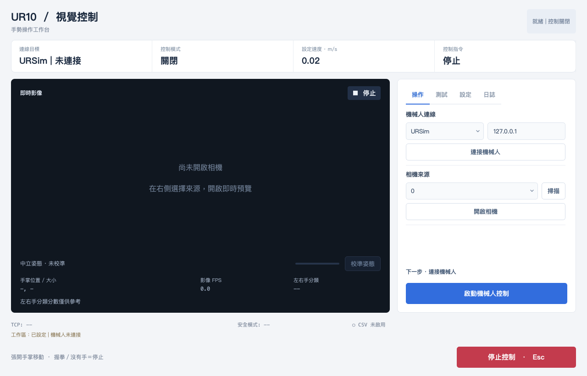
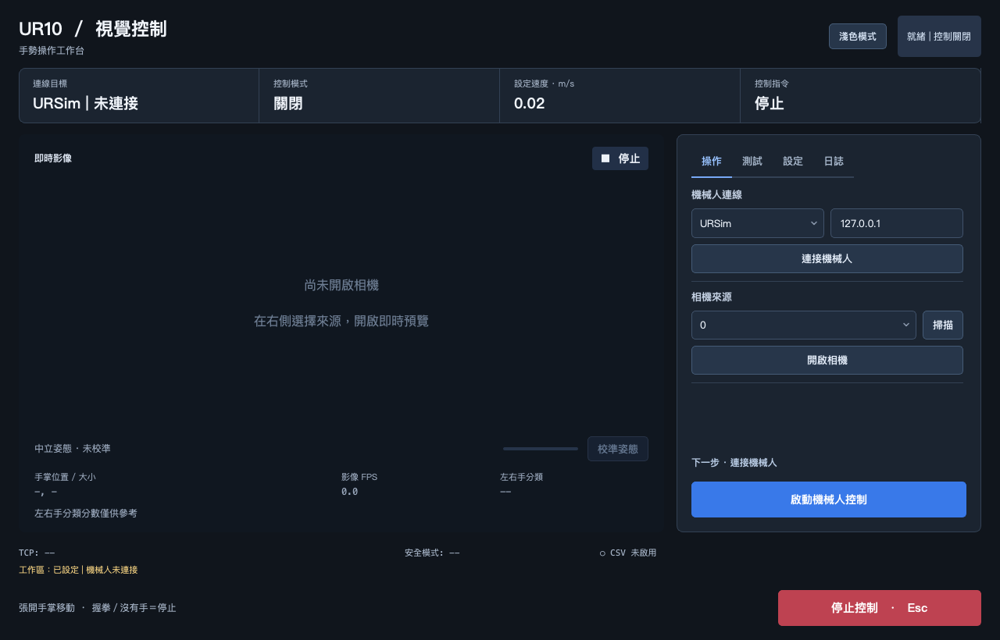

# Vision Controller operation

Detailed operation notes for the Qt controller. Start with the [suite README](../README.md) for installation and module setup.

## Interface

The main workspace keeps a large camera preview, calibration progress and gesture direction on the left. The top row shows connection, control mode, configured speed and the command last reported by the control worker. Gesture direction and worker-reported commands are separate; neither is measured robot motion. A pending STOP is displayed as **停止待確認**.

The right panel has **操作 / 測試 / 設定 / 日誌** tabs. Connection and camera controls are grouped with simple section dividers; a short next-action hint appears above the enable button. The hint reports state and never enables motion automatically. **校準姿態** sits beside the progress indicator below the preview. Detection/tracking, speed, dead zone and direction options are in **設定**; all URSim movement tests are in **測試**. Panel contents scroll on smaller windows, while the preview, enable button and bottom STOP remain visible. Escape also requests STOP while a modal dialog is open. The top-right **深色模式 / 淺色模式** button switches the theme immediately; the choice is saved in local settings and restored on the next launch.





## Camera and calibration

1. Select a camera index, or select **手動輸入** and enter an index / RTSP URL. Camera scanning runs separately and is available while capture and robot control are stopped.
2. Start the camera. Capture and MediaPipe inference run in a separate process.
3. Hold an open palm at your preferred neutral position and press **校準姿態** below the preview. Eight consistent valid open-palm frames define neutral X, Y and palm size. Closing the hand or invalid tracking resets calibration samples.
4. Check direction labels with robot control disabled. Horizontal zones are relative to the calibrated X centre; vertical zones use calibrated Y. **Dead zone** changes the horizontal and vertical neutral band.
5. **Detection / Tracking** changes take effect through **套用偵測／追蹤設定**. Applying restarts an active camera, disables control and requires new calibration. Smoothing, dead zone and size sensitivity are read during processing.

Only one translation direction is requested at a time. Large vertical offsets take priority over palm-size changes. Missing/invalid hand, closed palm or an unconfirmed direction requests STOP. Each new direction needs six matching frames. Palm size is a monocular depth proxy; rotation, lighting and perspective can affect it.

The displayed **左右手分類 / Handedness** score is left/right-hand classification confidence, not landmark accuracy or a safety probability. Motion validity uses finite/in-frame landmarks, geometric plausibility, three-frame continuity, open-palm detection and frame freshness. These are heuristic checks, not a calibrated confidence model.

## Robot operation and modes

See [CONNECTION_GUIDE.md](../CONNECTION_GUIDE.md). Connect only establishes communication: power, brakes and controller operating mode must be prepared manually in PolyScope. The app no longer sends automatic Dashboard power-on commands.

The controller has exclusive modes: **disabled, ready, gesture, axis test, return, fault**. Enabling with a calibrated active camera selects gesture mode; otherwise it enters ready mode for URSim tests. Mode changes request STOP first and invalidate old commands. Camera frames cannot send motion during axis tests or return. Tests finish with control disabled; they never automatically resume gestures.

The persistent **停止控制 (Esc)** button sends a software STOP. The status distinguishes a request from a STOP accepted by the RTDE call. This acknowledgement is not a measurement that the robot has become stationary. A physical emergency stop remains independent of the app.

URSim axis tests target 3 cm and finish based on TCP feedback, with a timeout. The short test targets 2 cm. Outward commands within the 5 mm outward stop margin of a URSim workspace wall stop and enter a supervised return to `(0.40, 0.00, 0.40)`, with a 0.005 m/s cap and a 30-second deadline. The deadline may abort returns from distant walls. A physical target never runs automatic test or return motions.

## Worker interlocks

`vision_control/transport.py` owns RTDE in a separate process. It checks:

- command age (0.35 s), processed frame age / capture health in gesture mode (0.35 s), and TCP feedback age (0.50 s);
- a progressing controller timestamp, safety mode NORMAL/REDUCED, finite vectors and a valid TCP workspace;
- mode ownership, a separate STOP generation and a latched fault generation.

Only the latest command is retained. STOP must be handled before a newer speed; old moves cannot queue up behind it. Feedback keeps the worker acquisition timestamp and cannot become fresh merely because Qt reads it later. Freshness checks continue without Qt callbacks. A 2 Hz controller communication watchdog is required before control becomes ready; failed setup blocks motion. A failed STOP is surfaced and watchdog kicks cease.

These are software thresholds, **not measured stopping times or certified safety guarantees**. Native calls, networking and the controller affect response. Image age is measured from the local capture call, not the remote camera exposure; RTSP buffering is not fully observable. Workspace checks cover the TCP, not robot links, tools or obstacles, and do not calculate validated braking distance. Use the controller's configured safety system and installation risk assessment.

## Physical workspace

Edit only the six `REAL_WORKSPACE_*` values in **`safety_config.py`**, after measuring and reviewing the actual installation in base-frame metres. Every axis must have finite `MIN < MAX`. Missing, malformed or reversed bounds block control and produce an axis-specific error. The application does not sort or invent bounds.

Physical startup speed resets to 0.02 m/s. With control disabled, choose the reviewed speed or press **確認目前實體速度** to confirm the current value. Persisted higher speeds never automatically arm physical control. The configurable 0.50 m/s ceiling is not a validated safe speed. The physical checklist supports CB3 and e-Series controller-mode differences.

## Structure and validation

```text
ur10_vision_qt_app.py     UI orchestration, connection and frame presentation
ur10_vision_app.py        Compatibility entry point
safety_config.py          Installation profiles and vector validation
vision_control/ui.py     Dashboard layout and styling
vision_control/settings.py  Validated atomic settings
vision_control/vision.py  Camera / inference / scan processes, quality checks
vision_control/gestures.py  Pure calibrated gesture mapping
vision_control/motion.py  Exclusive modes, test / return / operator interlocks
vision_control/policy.py  Pure worker freshness and workspace rules
vision_control/clock.py   Cross-process monotonic timestamps
vision_control/transport.py  RTDE worker, mailbox and controller watchdog
vision_control/logging.py CSV telemetry
monitor/                  Separate output-only RTDE monitor and browser dashboard
```

CSV files are written under `logs/`. `vision_request` is intent; `worker_dispatch` is the latest worker-reported accepted command, not measured velocity and not an exhaustive trace of every dispatch. `handedness_score` replaces the misleading `confidence` header in new logs. Historical logs are unchanged.

Run offline tests (no camera or robot connection):

```sh
QT_QPA_PLATFORM=offscreen python -m unittest discover -s tests -v
```

On Windows PowerShell, first set `$env:QT_QPA_PLATFORM = "offscreen"`, then run `python -m unittest discover -s tests -v`. The CI workflow runs this suite on Linux, Windows and macOS with Python 3.11. A workflow definition is not evidence that remote CI has run. See [validation and URSim checks](validation.md) and [FYP overview](../FYP_UR10_README.md).
